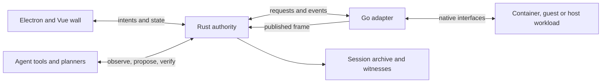
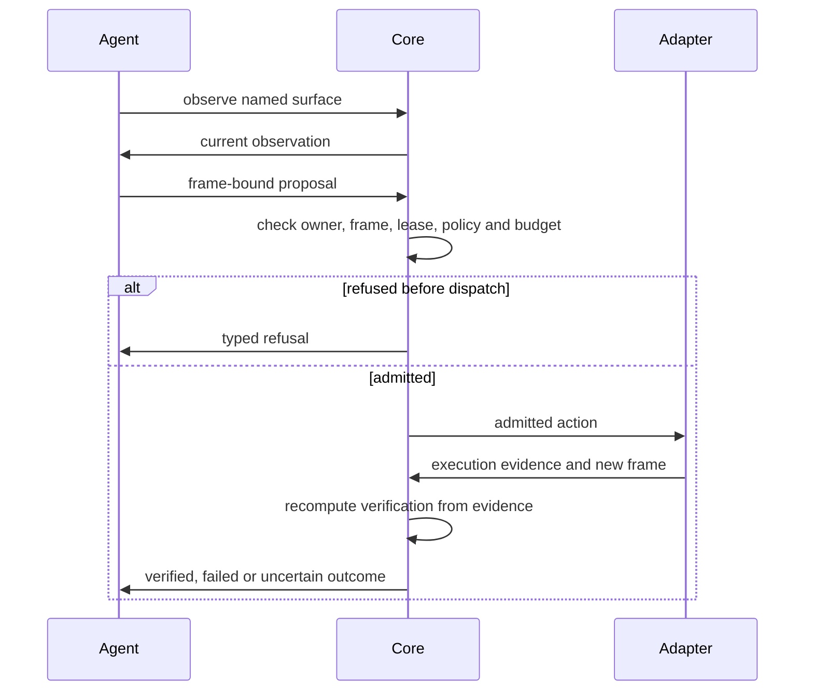

# Architecture

MetaViewer puts explicit admission between an agent's proposed input and its
native executor. The wall displays the resulting state; it does not decide
whether a proposed action is allowed. This document maps the public
implementation. [WHY_CAPSULES.md](WHY_CAPSULES.md) explains the design tradeoffs.

## Context and goals

The architecture separates presentation, authority and execution so that each
agent action has a named target, an admission decision and a recorded outcome.

Answers: why are the wall, core and adapter separate processes?



The split is a protocol boundary, not containment against a compromised process
running as the same host user. A workload's execution boundary depends on its
kind; Host program and Desktop window are not isolated.

Source map: [CITED: `core/src/admission/mod.rs`, `core/src/serve/mod.rs`, `daemon-adapter/internal/daemon/dispatch.go`, `ui/src/catalog/catalogModel.js`].

## Process and transport model

The Rust server receives versioned messages from registered peers. It binds
messages to a session and sender before changing authority state; the adapter
bridges admitted requests to native operations.

Answers: where do processes connect, and what makes a message admissible?

| Boundary | Public implementation | Responsibility |
| --- | --- | --- |
| UI to core | `ui/electron/coreLauncher.js`, `core/src/serve/mod.rs` | Start/connect to the core and exchange registered messages |
| Agent to core | `agents/metaviewer_agents/tools.py`, `core/src/serve/tools.rs` | Observe, propose and await verification |
| Adapter to core | `daemon-adapter/internal/daemon/environment.go`, `daemon-adapter/internal/ipc/` | Exchange lifecycle, input and frame events |
| Adapter to executor | `daemon-adapter/internal/capsule/manager.go`, `daemon-adapter/internal/cli/` | Validate native target and parse executor replies |

[CITED: paths in the table]. Messages use newline-delimited JSON envelopes.
Transport validation and stateful admission are separate checks: well-formed
JSON does not establish current ownership or frame freshness.

The adapter requires explicit positive transport limits and deadlines and
rejects settings above its fixed ceilings [CITED: `daemon-adapter/internal/ipc/config.go:20`]. Duplicate/non-increasing sender
sequences are handled separately from offline session replay [CITED: `core/src/replay/mod.rs`]. No proposed executor socket is needed to explain the
current adapter route.

## Contract-first rule and mapping

Contracts define permitted message shapes; the receiving implementation decides
which operations are available in the current state.

Answers: which messages connect observation, admission and execution?

| Message family | Purpose | Implementation to inspect |
| --- | --- | --- |
| `envelope`, `hello` | Session and peer identity, ordered transport | `core/src/wire/`, `core/src/serve/mod.rs` |
| `surface_request`, `surface_event` | Lifecycle, input and published surface state | `core/src/serve/mod.rs`, `daemon-adapter/internal/daemon/dispatch.go` |
| `frame_ref` | Captured bytes, geometry, digest and generation | `daemon-adapter/internal/frames/publisher.go`, `core/src/journal/mod.rs` |
| `action_proposal`, `action_verdict`, `action_receipt` | Proposed action, admission, execution and verification outcome | `core/src/admission/mod.rs`, `core/src/serve/tools.rs` |
| `ui_intent` | Layout and takeover requests | `core/src/serve/layout.rs`, `core/src/serve/mod.rs` |
| `capsule_state_request` | Stored profile data operations | `daemon-adapter/internal/capsule/slots/store.go` |
| Guest-command and Rewind messages | Guest execution and restore authority | `core/src/serve/guest_command.rs`, `core/src/serve/rewind.rs` |

[CITED: paths in the table; schemas in `contracts/`]. Read the decoder and
handler as well as the schema: schema presence alone does not prove a live
producer, a wired handler or support on the current host. Contribution rules
are in [LAWS.md](../LAWS.md).

## Capture and integration seams

The adapter publishes captured frames; the core validates their evidence before
using them; Electron reads verified bytes for presentation. A frame reference
alone is not proof that its pixels are available or valid.

Answers: how do pixels become evidence, and what depends on private components?

| Stage | Check or boundary | Source |
| --- | --- | --- |
| Native capture | Capture the configured workload and publish immutable frame metadata | `daemon-adapter/internal/frames/publisher.go` |
| Core witness | Validate bytes, digest, geometry and generation for the surface | `core/src/journal/mod.rs`, `core/src/serve/mod.rs` |
| UI delivery | Validate frame input before exposing it to tiles | `ui/electron/frameReader.js` |
| Perception/planning | Cross the configured process interface | `agents/metaviewer_agents/perception/vcore.py`, `agents/metaviewer_agents/wender_bridge.py` |

[CITED: paths in the table]. `wender-agent`, `vision-engine` and
`OpenSuperficies` are separate private programs. Their pins are declared in
`deps.lock`; public code documents how MetaViewer calls them, not their internal
algorithms or containment implementation. Licensing and judge evaluation rights
are defined by [NOTICE-EVALUATION.md](../NOTICE-EVALUATION.md).

A digest match establishes byte identity. It does not establish that a visual
element has the intended meaning, or that the application stayed unchanged
until input arrived. Retained session witnesses and live shared-memory frames
also have different lifetimes; do not substitute a vanished live frame for the
archive required by replay.

## See, propose, admit, act, verify

The agent observes a surface, proposes an action tied to that observation, and
waits for the core's admission and verified outcome before proceeding.

Answers: what is the control loop, and where can it refuse work?



`CoreState::check` is used for admission and dispatch. It rejects unavailable
ownership, stale digest/generation, pending refresh, conflicting surface or
display leases, and invalid budgets [CITED: `core/src/admission/mod.rs:1307`].
Verification uses evidence from the capture owner rather than merely trusting
an executor success bit [CITED: `core/src/verify/mod.rs:32`, `core/src/serve/tools.rs`]. A successful input receipt is not a semantic task
completion claim.

The provider bridge exposes observe/list/propose/wait-for-verification tools;
the stdio MCP layer delegates to the tool client and does not own admission
[CITED: `agents/metaviewer_agents/mcp_server.py:1`]. Operational entry points
and refusal recovery belong in [AI_OPERATOR_GUIDE.md](AI_OPERATOR_GUIDE.md).

## Fold, unfold, pin and take control

Layout changes affect presentation; takeover changes input authority. Folding
a tile does not itself revoke the agent's ownership.

Answers: how is moving or hiding a tile different from taking control?

The core admits supported placement transitions through its layout handler.
Hidden slots must be shown before placement or folding changes; layout does
not create, stop or rebind terminal sessions [CITED: `core/src/serve/layout.rs:1`, `core/src/serve/layout.rs:29`]. The server routes
fold, unfold, move, tab, float, hide and show to that handler; other layout
operations must not be assumed supported just because a UI control exists
[CITED: `core/src/serve/mod.rs:1791`].

Take control records the authority transition and cancels undispatched work.
Dispatched or unknown work can remain draining: takeover is not an undo. Release
and subsequent admission must respect that state and acquire fresh observation
[CITED: `core/src/admission/mod.rs:1262`, `core/src/serve/mod.rs:1791`]. Role
switching has a separate request/result path and availability checks [CITED: `core/src/serve/role_switch.rs:29`].

## Create and destroy

The adapter validates a requested native target before starting it, and it
retains uncertain custody instead of pretending that a workload has disappeared.

Answers: when does a capsule exist, and when is its identity reusable?

Kind, profile and geometry must match an admitted configuration [CITED: `daemon-adapter/internal/capsule/manager.go:818`]. On agent-mode creation, the
adapter captures and publishes an initial frame. If that capture fails, it
attempts bounded compensating destruction and preserves the committed identity
in the error. Human-mode openings do not require the same agent frame consumer
[CITED: `daemon-adapter/internal/daemon/dispatch.go:73`].

Lost bindings retain profile and capacity because the native process may be
orphaned. A verified stop is needed to release custody; a missing frame or
transport failure is not proof of successful cleanup [CITED: `daemon-adapter/internal/capsule/manager.go:862`]. Stored profile data operations
also check custody and compatibility [CITED: `daemon-adapter/internal/capsule/slots/store.go:274`].

## Core authority and replay

The core records an ordered state transition before replacing current authority
state. Replay reconstructs those transitions from a complete session archive.

Answers: what does the journal prove, and how does it differ from anti-replay?

`Authority::apply_with_witnesses` computes the next state, appends the transition
and witnesses, then installs that state [CITED: `core/src/admission/mod.rs:1514`]. The journal independently recomputes the
transition and checks sequence, previous-record digest and required witnesses
[CITED: `core/src/journal/mod.rs:3123`]. Frame persistence can use bounded group
commit; do not describe every visible frame as independently synced to disk
[CITED: `core/src/journal/mod.rs:59`].

| Mechanism | Purpose | Source |
| --- | --- | --- |
| Transport anti-replay | Refuse duplicate/non-increasing sender messages | `core/src/replay/mod.rs` |
| Session replay | Validate archive closure and reconstruct recorded state | `core/src/journal/mod.rs:3867` |
| Optional external anchor | Check against a separately supplied protected journal head | `core/src/journal/anchor.rs`, `core/src/bin/mv-replay.rs:28` |

[CITED: paths in the table]. Archive consistency alone is not independent proof
of the archive's origin. Keep the journal, sidecars, genesis and witnesses
together; a copied log line is insufficient.

```bash
mv-replay --journal <session-journal> --witness-root <session-root> --verify-only
```

Without `--verify-only`, the command prints the reconstructed state digest.
Invalid input, duplicate evidence and witness failure produce nonzero exits
[CITED: `core/src/bin/mv-replay.rs:42`]. Replay does not inject input into a live
application. If journal capacity is exhausted, the server closes admission,
initiates ordered stopping and asks for a new session [CITED: `core/src/serve/journal_end.rs:128`].

## Supervisor and process safety

Starting a process and proving its cleanup are distinct operations. The public
supervision modules and launchers must be evaluated at their actual call sites.

Answers: does the presence of a supervisor module prove all processes use it?

No. Inspect `core/src/supervisor/` for its library contract and
`ui/electron/coreLauncher.js` for Electron's core lifecycle. Do not infer
end-to-end containment or complete cleanup from a module name, a terminated
parent or a requested stop. The adapter's retained custody on uncertain native
state is part of this distinction [CITED: `daemon-adapter/internal/capsule/manager.go:862`].

## Security and platforms

Control checks restrict admitted operations; they do not turn host-backed
workloads into isolated guests or make captured content safe to publish.

Answers: which trust and platform boundaries remain outside the core?

| Boundary | Consequence | Evidence |
| --- | --- | --- |
| Host program/window | Input and programs retain host exposure | `ui/src/catalog/catalogModel.js:117` |
| Private executor | Public tests can check the seam, not its internals | `NOTICE-EVALUATION.md` |
| Captured pixels and profile data | Screens, inputs and slots may contain private data | `daemon-adapter/internal/capsule/slots/store.go:274` |
| Guest availability | Supported architecture and protected profile are required | `ui/electron/guestCommandProfile.js:5` |
| Rewind | Guest restore does not retract external effects or authority history | `core/src/rewind_flow.rs` |

[CITED: paths in the table]. A successful cross-build is not live platform
qualification. See [ARM64_CAPSULE_SETUP.md](ARM64_CAPSULE_SETUP.md) for the guest
path and [INSTALL.md](INSTALL.md) for installation prerequisites.

## Testing and CI

Use the repository's tests to check contracts and implementation; use live
receipts to establish behavior of the assembled runtime on a particular host.

Answers: how can a contributor verify an architecture claim?

Read the cited handler and its tests, then run the relevant suite. The aggregate
entry point is `tools/gate.sh`; exact build prerequisites belong in
[TESTING.md](TESTING.md). A documentation-only change can first run:

```bash
python3 -B -m unittest discover -s tests -p 'test_*doc*'
```

Anchor and coordinate checks detect structural mistakes. They cannot prove that
a sentence follows from the source it cites. Likewise, fake executor tests do
not qualify a private native runtime. Report the command and scope actually
checked, retaining failed or unavailable results.

## Open questions

Live performance and deployment assurance remain bounded by the evidence that
is actually available.

Answers: what does this architecture description leave unproved?

Per-kind startup latency, resident memory, broad platform qualification and
comparative reliability require dedicated receipts: **ABSENT — do not invent**
where none are published. Reported live results remain maintainer reports;
source inspection must not promote them to independent measurements. Private
implementation review is outside the public checkout.

The mandate of this document is limited to the cited public repository and
explicitly attributed reports.
