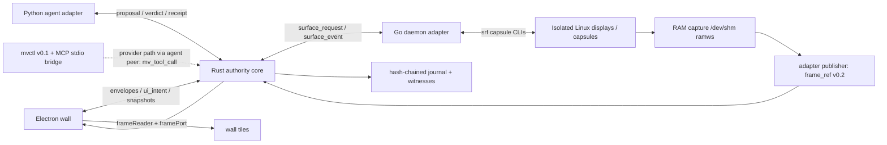

# Architecture

## Context and goals

I built MetaViewer to present independent Linux application surfaces as a live
wall. Visibility and control are separate: folding a surface saves presentation
work but does not stop capture, agent reasoning or verification. I built the
Rust core as the single authority over lifecycle, admission, budgets, locks and
durable session order. Electron renders state and submits intents. It never
injects input.

Release **0.1.1** [CITED: VERSION] carries the v0.2 contracts and the
integration laws. Every process behavior below is implemented as described
unless it is marked "planned for v0.2.0". Features I have not integrated end
to end yet (AI loop on Holdings, recording, catalog, packaging) are marked
that way and never described as done: recording, catalog and verification
logic exists as offline seams, but the serving core does not call it yet.



Two diagram notes: the core currently answers agent `observation` bodies with a
journalled `POLICY` verdict (intake planned for v0.2.0), and `mv_tool_call` is
served only to the registered agent peer — `mvctl` defaults to legacy
`envelope/v0.1`, with an explicit `mvctl --v02` mode that speaks the v0.2 tool
protocol as that agent peer, and the MCP server never opens sockets.

I describe the UI kit shell, wall layout and terminal in
[UI_ARCHITECTURE.md](UI_ARCHITECTURE.md). Pre-existing components are declared
in [PREEXISTING.md](PREEXISTING.md), and the delivery plan in
[ROADMAP.md](ROADMAP.md).

## Process and transport model

I start Electron, and its core launcher spawns the pinned core binary at most
once per instance and never respawns it (`ui/electron/coreLauncher.js`). The
launcher scrubs the child environment, reaps through an ownership ledger with
a single-pid kill guard, and completes an authenticated hello handshake before
the core is used. Rust exclusively owns application state from that point on.

The core listens on `$XDG_RUNTIME_DIR/metaviewer/core.sock`
(`core/src/bin/metaviewer-core.rs`). Startup requires `MV_CORE_CONFIG` and
`XDG_RUNTIME_DIR`; it fails without them. `MV_CORE_CONFIG` holds a closed
registration (`core/src/serve/mod.rs`): `{session_id, core:{endpoint,hello},
peers:[{endpoint,hello}]}`, with exactly one registered agent and one
registered daemon; UI peers may also register. The core endpoint instance is a
fresh process identity on each restart. The core also refuses a registration
whose core hello `component_version` differs from its compiled package
version, before creating sockets or session state.

| Socket under `$XDG_RUNTIME_DIR/metaviewer/` | Status | Owner and callers |
| --- | --- | --- |
| `core.sock` | Implemented | Core listens; UI, agent and daemon adapter connect as clients |
| `surfaces.sock` | Path helper implemented, listener mode available to embedders | Adapter currently connects to `core.sock` as a client; `Listen` exists for embedders (`daemon-adapter/internal/ipc/socket.go`) |
| `executor.sock` | Planned for v0.2.0 (TBD, not yet implemented) | No listener exists; the daemon adapter currently receives dispatched proposals |

The daemon adapter currently connects to `core.sock` as a client
(client-first handshake, `daemon-adapter/internal/daemon/environment.go`).
Every connection is peer-credential checked (`SO_PEERCRED`, UID equality) on
both sides, directories are owner-only `0700`, sockets are `0600`, symlink
parents and redirected rendezvous points are refused, and stale sockets are
removed only after a connect probe proves them dead.

Framing is UTF-8 newline-delimited JSON: a newline terminates one JSON value.
These limits are implemented, not proposed:

| Limit | Core | Adapter |
| --- | --- | --- |
| Max frame bytes | 1 MiB (`core/src/wire/mod.rs`) | 1 MiB (`daemon-adapter/internal/ipc/config.go`) |
| Max JSON depth / string / keys / array items | shared wire limits | 32 / 64 KiB / 256 / 4096 |
| Handshake deadline | 5 s | 5 s hello timeout |
| Idle read deadline | 30 s | 30 s read timeout |
| Send queue | 256 envelopes | synchronous writes (backpressure, no unbounded queue) |
| Replay entries | capacity-bounded table | 100000-entry durable `wire-replay.jsonl` |

Every wire message is an `envelope/v0.2` containing a typed body with its own
schema discriminator. I reject unknown versions and unknown properties. `seq`
strictly increases per authenticated sender instance within a session; a fresh
instance starts a fresh sender sequence. The core records accepted
nonce/sequence pairs in its replay table (`core/src/replay/mod.rs`) and the
adapter in its durable replay file; both refuse duplicates before execution,
including after restart. `ts_ns` is a nonnegative integer timestamp;
sequence order, not clock order, is authoritative (monotonic clock
enforcement is TBD, not yet implemented). Units in field
names are normative. The wire has no reply correlation beyond envelope
identifiers (`mv_tool_result.request_id` echoes the envelope `msg_id`); richer
correlation remains an open protocol question.

Durable core state lives under `$XDG_STATE_HOME/metaviewer`, or
`$HOME/.local/state/metaviewer` when `XDG_STATE_HOME` is unset
(`core/src/journal/mod.rs`).

## Contract-first rule and mapping

I follow law L3 ([LAWS.md](../LAWS.md)): a schema and its positive/negative
examples land before any producer or consumer, a breaking change opens a new
contract directory, and old versions stay until no pin uses them.
`contracts/v0.1/` is untouched; v0.2 is the integrated set (20 v0.2 schemas
against 10 v0.1 [MEASURED: `ls contracts/v0.2/*.schema.json | wc -l`]).
Draft **2020-12**
is the schema dialect, every object sets `additionalProperties: false`, every
message value carries a `<name>/v0.2` discriminator const, and `$ref` names a
sibling schema file, optionally with a `#/$defs/...` fragment (no
cross-directory references). The checker (`tools/check_contracts.py`) implements
only this documented subset and rejects unknown keywords; it is not a general
JSON Schema implementation. The full rules are in
[contracts/v0.2/README.md](../contracts/v0.2/README.md).

| Contract | Producer → consumer | Meaning |
| --- | --- | --- |
| envelope | Any process ↔ core | Identity, session, ordered sender sequence, nonce, typed body |
| surface | Embedded snapshot shape (inside events and tool views) | Authoritative surface data after validation; no bare-surface flow exists |
| surface_request | UI/agent → core → adapter | Closed per-operation parameters (create, list, destroy, frame_subscribe, frame_unsubscribe, input, record_start, record_stop, take_control, release_control); the core currently admits create, list, destroy and subscribe/unsubscribe, and answers the rest with a journalled POLICY verdict |
| surface_event | Adapter → core → UI | created, state_changed, frame_ready, input_applied, error |
| frame_ref | Adapter publisher → core → UI | Immutable rgb24 frame locator and integrity metadata |
| observation | Agent adapter → core (planned for v0.2.0: core intake is a stub) | Frame, grounded visual elements and optional Holdings state witness; the core currently answers POLICY |
| action_proposal | Agent → core → daemon (current executor) | Frame-bound action, next-observation predicate and bounded retries/time |
| action_verdict | Core → agent | Admission/refusal and authoritative sequence; only refusals carry a reason |
| action_receipt | Daemon → core → agent (forwarded unchanged; `verify_receipt` exists as an offline seam, serve wiring planned for v0.2.0) | Execution time, next frame, daemon-reported verification result/method and error text |
| session_record | Core → durable journal; also an envelope body in v0.2 | Ordered append-only event referencing a persisted envelope and prior-record digest |
| hello | Every process ↔ core | Handshake: contract version, component name, pinned version and commit |
| capsule_meta | Schema only (planned for v0.2.0: no producer yet) | Container, display, framebuffer path, lane socket, ready line from the capsule CLI, never guessed |
| ui_intent | UI → core | Closed UI ops: fold, unfold, hide, show, pin, move, tab, float, layout save/load, take_control, release_control; the core currently admits fold, unfold, take_control and release_control, and answers the rest with a journalled POLICY verdict |
| catalog_entry | Core → UI | New capsule kinds and allowed profiles (planned for v0.2.0: pure catalog authority implemented offline, no serve route arm yet) |
| terminal_session | UI broker implements; core side planned for v0.2.0 | Spawn spec by provider id with server-owned argv, resize, byte-plane messages, cumulative ACK, resync |
| record_request | UI → core → adapter | RAM recording, disk recording (destination required), screenshot (planned for v0.2.0: offline record authority and adapter record Manager exist, no serve route arm yet) |
| record_event | Adapter → core | Recording lifecycle and capture events (planned for v0.2.0) |
| settings | UI-local store; core sync planned for v0.2.0 | Theme, providers, record destination, limits; no secrets |
| mv_tool_call | Registered agent peer → core | observe, list, propose, wait_verify for provider CLIs (`mvctl --v02` uses observe/propose/wait-verify as the agent peer; MCP use is planned) |
| mv_tool_result | Core → mvctl/MCP | Terminal outcomes for tool calls |

`surface_request.list` has empty parameters; the adapter emits a `created`
snapshot for each non-destroyed surface in sorted-by-id order. No arbitrary extensible JSON
object is permitted in this contract version. `lane_submit.payload` is a
closed adapter command record (`{nonce, seq, command, args}`, plus a `verb`)
in `contracts/v0.2/action_proposal.schema.json`. It is **not** a claim about
the native Holdings wire shape; the adapter must translate it only after that
shape is confirmed. All action variants and all daemon operations have closed
parameter objects. `frame_ref` and the other embedded message-shaped values
retain their own schema discriminator.

## Capture and integration seams

| Component or seam | Verified fact [CITED] | Adapter behavior |
| --- | --- | --- |
| Capsule CLIs | `srf-identity-surface` and `srf-holdings-capsule` under `MV_SRF_BIN_DIR`; allowlisted env; single-line bounded closed JSON replies; exit map 2 usage, 3 setup, 4 unavailable, 5 malformed, 6 refused, 7 cli_failed (`daemon-adapter/internal/cli/runner.go`, `daemon-adapter/internal/capsule/process.go`) | Run CLIs only from the pinned bin dir with the allowlisted environment; parse with `cli.ParseLine`; map exits to typed faults |
| Capsule kinds | `browser`, `desktop_capsule`, `vm`, `game_capsule` (`daemon-adapter/internal/capsule/manager.go`); profiles from `MV_SRF_PROFILES` or one live profile (`:100`, 1280x900 browser); max 16 surfaces | Refuse unadmitted profile, kind or geometry before spawning |
| RAM capture | Publisher requires a `/dev/shm/` RAM root on tmpfs owned by the current uid, writes `0600` files with `O_NOFOLLOW`/`O_EXCL`, and verifies sha256 before publishing (`daemon-adapter/internal/frames/publisher.go`) | Publish complete immutable generations with dimensions, digest and capture duration; read only after publication |
| Core frame witness | `/dev/shm` prefix, no `..`, per-component symlink walk, `O_NOFOLLOW`, regular file up to 64 MiB, digest match (`core/src/serve/mod.rs`) | A path-shaped string is not authorization; mismatches are refused, never journaled as frames |
| Electron frame reader | `/dev/shm/` prefix, no `..`, generation ≥ 1, `^[0-9a-f]{64}$` digest, per-surface generation lease, null-digest fail-closed (`ui/electron/frameReader.js`) | Verify before handing bytes to tiles through the frame port; paths never cross IPC |
| vision-engine | Pin `v0.2.0`, commit `9bbb49f220837388e1ab90c34ae0eedee27a66eb` [CITED: deps.lock] | Python package pin; runtime behavior TBD (not yet integrated) |
| wender-agent | Pin `v0.3.0`, commit `7648b258d1d04953bacffe8627de5acd7c75d817` [CITED: deps.lock] | Python package pin; runtime behavior TBD (not yet integrated) |
| OpenSuperficies | Pin `os-cu-w9-mv1`, commit `a9ac1ac8543872b428990ea23fa2629cd0a6d1d5` [CITED: deps.lock] | Go binary pin; runtime behavior TBD (not yet integrated) |
| Holdings lane | `lane_submit` verb plus `state_sha256` witness in v0.2 contracts; AI loop on Holdings planned for v0.2.0 | Bind lane to capsule, verify readiness and chain, use state digest plus tick windows |

Capture generations increase when a framebuffer allocation or display is
replaced. A digest alone cannot identify freshness across generations. The
publisher assigns each immutable allocation a publication generation, the core
records `(sha256, generation, width, height)` per surface, and the Electron
reader binds each lease to its surface generation. End-to-end frame lease
lifetimes across crash recovery remain an open question.

Because the core verifies and fsyncs each `3,456,000`-byte (`1280x900` RGB24)
frame witness and journal record before fanning `frame_ready` out to the UI
(`678.84 ms` mean, `692.71 ms` max per frame, during which a `100 ms` poll loop
advances `~6.8` generations [MEASURED: `cargo test --manifest-path core/Cargo.toml frame_ready_latency_and_concurrent_generations_on_3_45mb_frames`]),
the publisher retains each `/dev/shm` generation for at least `4 s` (`>= 2 s`
floor [TARGET, unit decision]), bounded by `128 MiB` per surface (`~38`
full-resolution frames [TARGET, unit decision]), `512 MiB` globally across
surfaces, and at most `64` generations per surface (`daemon-adapter/internal/frames/publisher.go`),
while active subscriptions suppress duplicate publications and `frame_ready`
emissions after the initial `2` confirmation polls whenever `sha256_rgb24` and
geometry are unchanged (`daemon-adapter/internal/frames/subscriptions.go`)
[TARGET, unit decision].

Holdings pixels are not keyed by state. A pixel change alone cannot prove a
Holdings state transition. The v0.2 contracts carry `ground_truth.source=holdings_lane`
with a `state_sha256` witness and tick (`observation`), and the
`state_sha256_change` predicate carries `before`, `min_tick` and `max_tick`.
The core currently checks only that `min_tick ≤ max_tick` plus the per-lane
nonce/sequence binding (`core/src/admission/mod.rs`); validating the digest
chain against live lane state is planned for v0.2.0. Nonce and
sequence in the lane payload are also subject to native replay refusal. Core
verification of receipts is planned for v0.2.0: `core/src/verify/mod.rs`
implements `verify_receipt` as an offline seam, but serve does not call it
yet, so the core currently forwards daemon receipts unchanged, and only
`mv_tool` waiters receive `VERIFICATION_FAILED` for unverified outcomes —
never a silent promotion to success.

The adapter manager currently answers `frame_subscribe`, `frame_unsubscribe`,
`record_start` and `record_stop` with a typed unsupported refusal; continuous
native subscription and end-to-end recording are planned for v0.2.0.
RAM-first recording logic exists as an offline adapter Manager
(`daemon-adapter/internal/record/`), not yet wired into dispatch. The initial
frame published synchronously on `create` is implemented.

## See, propose, admit, act, verify

```mermaid
sequenceDiagram
    participant C as Rust core
    participant D as Daemon adapter (current executor)
    participant A as Agent / vision adapter
    D->>C: envelope(surface_event.frame_ready)
    C->>A: envelope(frame_ref via fanout subscription)
    A->>C: envelope(action_proposal)
    C->>C: validate version, frame, ownership, lock, policy, budget
    alt refused
        C->>A: envelope(action_verdict refused + reason)
    else admitted
        C->>C: persist admission and reserve execution budget
        C->>A: envelope(action_verdict admitted)
        C->>D: envelope(admitted action_proposal)
        D->>C: execute through capsule CLI / lane
        D->>C: envelope(surface_event.input_applied)
        D->>C: envelope(surface_event.frame_ready)
        C->>A: envelope(frame_ref)
        D->>C: envelope(action_receipt)
        C->>C: match receipt to dispatch epoch; outcome verification planned
        C->>A: envelope(action_receipt unchanged)
        C->>C: append session_record and persisted envelopes
    end
```

Agent `observation` intake is planned for v0.2.0: the core currently answers
observations with a journalled `POLICY` verdict, so the loop above runs on
proposals bound to fanned-out frames.

Execution facts arrive as `action_receipt/v0.2` from the daemon; the core
matches each receipt to its dispatch epoch (`Input::Receipt` vs `Input::Drain`)
and forwards it to the registered agent unchanged. The daemon reports
`verified: false` until core verification exists. The verification module
(`core/src/verify/mod.rs`, owned by W2-AILOOP) implements `verify_receipt`
and `read_published_frame` as an offline seam not yet wired into serve, so
outcome verification and the AI loop on Holdings are planned for v0.2.0. Retries
consume budget (one unit per proposal) and require fresh admission against the
current frame; a failed recheck consumes the old permit. A proposal must belong to
the same surface and generation it is based on; visual predicates use window coordinates,
never wall-scaled UI coordinates.

Provider CLIs use the same authority through
`mv_tool_call/v0.2` (`observe`, `list`, `propose`, `wait_verify`), served by
the core tool router for the registered agent (`core/src/serve/tools.rs`).
`mvctl` defaults to the legacy `envelope/v0.1`, with an explicit `--v02` mode
(`observe`, `propose`, `wait-verify`) that speaks the v0.2 tool protocol as
the registered agent (`agents/metaviewer_agents/mvctl.py`); the MCP server is
a stdio bridge that never opens sockets
(`agents/metaviewer_agents/mcp_server.py`).

## Fold, unfold, pin and take control

Fold and unfold are admitted layout intents: the core journals them as
notices and fans out the updated surface view (`layout_intent` in
`core/src/serve/mod.rs`, addressed by `slot_id`, refused with `POLICY` unless
the surface is live and has a tool view). Hide, show, pin, move, tab, float
and layout save/load stay UI-local presentation: the wall builds
`ui_intent/v0.2` bodies and tracks visibility
(`folded`/`unfolded`/`pinned`) in its own projection
(`ui/src/core/intents.js`, `ui/src/core/projection.js`), while the core
answers those `ui_intent` bodies with a journalled `POLICY` verdict. Core
admission of the remaining visibility intents is planned for v0.2.0. Capture
and agent loops continue regardless of folding.

```mermaid
sequenceDiagram
    participant U as Electron UI
    participant C as Rust core
    participant D as Daemon adapter
    participant A as Agent
    U->>U: hide/show/pin/move/tab/float (local projection)
    U->>C: envelope(ui_intent hide/...)
    C->>U: envelope(action_verdict refused POLICY)
    U->>C: envelope(ui_intent fold/unfold slot_id)
    C->>C: journal notice; fan out updated surface view
    C->>U: envelope(fanned-out surface event)
    Note over C,A: capture and agent loops continue while folded
    U->>C: envelope(ui_intent take_control)
    C->>C: cancel in-flight proposals; set human ownership
    C->>D: envelope(surface_request take_control owner=human)
    D->>C: envelope(surface_event state_changed)
    C->>A: envelope(action_verdict refusals + surface event)
    C->>U: envelope(fanned-out surface event)
    U->>C: envelope(ui_intent release_control)
    C->>D: envelope(surface_request release_control)
    D->>C: envelope(surface_event state_changed)
    C->>C: refresh frame and ownership before agent admission resumes
    C->>U: envelope(fanned-out surface event)
```

Layout intents travel on the dedicated versioned contract `ui_intent/v0.2`
(`contracts/v0.2/ui_intent.schema.json`); `fold`, `unfold`, `take_control`
and `release_control` are admitted by the core today.

Control uses explicit operations. `Input::TakeControl` clears agent control,
cancels every in-flight proposal for the surface with the typed takeover
refusal `SURFACE_NOT_AGENT_CONTROLLED`, and marks the surface for a frame
refresh; `Input::ReleaseControl` is refused with `POLICY` while any action for
the surface is still draining (`core/src/admission/mod.rs`). Each admitted action
holds an exclusive injection lease for its surface (same-display conflicts
refuse with `LOCKED_BY_OTHER`); takeover cancels pending proposals. Pinning affects layout only.
Folding never revokes agent ownership by itself. `core/src/control/mod.rs`
(owned by W2-HUMAN-INPUT) implements only `publish_frame`, a
strictly-newer-generation gate; operator transitions stay in serve, so the
full human-input path is planned for v0.2.0.

## Create and destroy

```mermaid
sequenceDiagram
    participant U as UI
    participant C as Rust core
    participant D as Daemon adapter
    participant S as Capsule / daemon
    U->>C: envelope(surface_request create)
    C->>C: journal request; charge budget
    C->>D: envelope(surface_request create)
    D->>D: validate profile, kind, geometry
    D->>S: start capsule and await ready line
    S->>D: container/display/framebuffer/lane metadata
    D->>D: capture and publish initial frame
    D->>C: envelope(surface_event created)
    D->>C: envelope(surface_event frame_ready)
    C->>C: register surface; append record; fan out
    U->>C: envelope(surface_request destroy)
    C->>C: journal request; charge budget
    C->>D: envelope(surface_request destroy)
    D->>S: stop capsule and release resources
    D->>C: envelope(surface_event state_changed destroyed)
    C->>C: mark not-live; cancel actions; append terminal record
    C->>U: envelope(fanned-out destroyed event)
```

The core journals each lifecycle request before forwarding it, and the adapter
manager validates profile, kind and geometry against the configured profiles
before spawning. `create` publishes one initial frame synchronously with
transport backpressure; if initial capture fails, the adapter runs a bounded
compensating destroy and reports the committed identity
(`daemon-adapter/internal/daemon/dispatch.go`). Failed readiness produces
`surface_event.error`; no agent action is admitted. Unexpected disappearance
yields `lost` rather than a fabricated clean destroy. A terminal surface
cannot be revived under its old identifier.

## Core authority and replay

The core serializes all mutations through one server that assigns `core_seq`.
It authenticates the sender and session before interpreting the body, rejects
malformed envelopes and replayed nonces/sequences, and records refusals as
well as admissions. Protocol errors without a valid proposal identifier are
transport errors; well-formed but inadmissible proposals receive a typed
refusal. Unsupported well-formed messages receive journalled `POLICY` verdicts
keyed by request/message id, and a saturated peer gets a terminal
`surface_event.error` `QUEUE_OVERFLOW` through a reserved slot before
disconnection.

| Admission check | Refusal reason |
| --- | --- |
| Digest/generation absent, stale or no longer current | STALE_FRAME |
| Human ownership, terminal/lost lifecycle, disallowed shared ownership | SURFACE_NOT_AGENT_CONTROLLED |
| Another owner holds the display/window injection lease | LOCKED_BY_OTHER |
| Proposal deadline, retries, session budget exhausted | BUDGET_EXCEEDED |
| Coordinates or expected bounding boxes exceed the current window | OUT_OF_BOUNDS |
| Unsupported action, unauthorized sender, replay, invalid tick interval, lane replay refusal or other policy failure | POLICY |

Schema validation is necessary but cannot prove these stateful conditions. I
acquire the display/window lock and reserve budget atomically at admission and
recheck frame and ownership at dispatch to close races.

Session records are append-only references, **not sufficient replay material
alone**. I persist every referenced envelope and frame/state witness in the
session journal before recording its identifier. Each journal starts with a
`genesis.json` (`metaviewer.archive/v1`) binding the header digest and the
`core_seq = 0` genesis state; subsequent records carry gapless `core_seq` from
1, `msg_id` of `event-<core_seq>`, and the previous record's `prev_sha256`
over canonical JSON bytes (UTF-8, sorted keys, compact separators, integers
only). I verify the chain, referenced envelopes and witness hashes before
replay (`journal::verify_chain`, `journal::scan`). The frame itself remains
outside JSON; retained frame bytes or archived verified state witnesses are
required for outcome replay.

Two mechanisms share the name "replay", and I keep them distinct:

- Anti-replay: `core/src/replay/mod.rs` is the bounded nonce/sequence table
  that refuses duplicate or non-increasing sender sequences online.
- Session replay: `journal::scan` plus the `mv-replay` binary rebuild state
  from the journal and witnesses without touching live processes:

```bash
mv-replay --journal <session.journal> --witness-root <witnesses> [--verify-only]
```

Without `--verify-only` it prints the resulting state digest; exit codes are 2
for invalid input, 3 for duplicate evidence and 4 for witness failure
(`core/src/bin/mv-replay.rs`).

Replay reconstructs core state using logged inputs, decisions and ownership
transitions in recorded order. It never reinjects live
actions, queries a live model or rereads wall-clock time. Crash recovery
cannot infer whether an interrupted external input executed: the core marks
its outcome unknown, refreshes ground truth and refuses re-execution until
reconciled. Proving the transactional journaling and crash boundaries with
failure injection remains an open test task.

## Supervisor and process safety

I supervise adapter processes with the Rust supervisor (`core/src/supervisor/`)
as a unit: four services (`Daemon`, `Agent`, `Vision`, `Executor`), explicit
lifecycles, typed loss reasons, and a `ReapReceipt` (`reaped`, `surviving`,
`failures`, `complete`) for every stop. Each service runs under a private
Python subreaper (`reaper.py`, embedded in the binary) that exposes pidfds
without unsafe Rust; the host supplies the canonical interpreter path. Launch
validation requires canonical absolute program and working-directory paths,
an environment allowlist (it refuses `LD_*`, `DYLD_*`, `PYTHON*`, `NODE_*`,
`ELECTRON_*` and variables such as `BASH_ENV`), isolated Python flags
(`-I -S -B`) with an empty non-writable working directory for non-daemon
services, and all timeouts bounded (reap and startup each at most 60 s).
Spawning the core itself is currently Electron's job (spawn once, never
respawn, ownership ledger, kill guard); wiring the Rust supervisor into the
serving core is planned for v0.2.0.

## Security and platforms

Contracts carry no credentials, tokens, cookies or profile contents.
`profile_id` references an external persistent profile registry. I treat all
text and vision content as untrusted data, not instructions granting
privileges. I enforce surface-to-container/display/window mappings,
per-display isolation locks, owner-only capture buffers and strict runtime
peer authentication. I validate `ramws_path` at three layers (adapter
publisher, core witness, Electron reader), avoid symlink traversal, and verify
actual bytes; a path-shaped string is not authorization. My policy is to never
log secrets in free-text summaries, input text or errors. Session fixtures are synthetic;
runtime capture/log retention and redaction require explicit policy.

Electron security is deny-by-default (`ui/electron/main.js`): I build frozen
`BrowserWindow` options with `sandbox`, `contextIsolation` and `webSecurity`
on, `nodeIntegration` (plus worker and subframe variants), `webviewTag`,
`allowRunningInsecureContent` and `experimentalFeatures` off, and a
length-bounded NUL-free preload path. The renderer talks to main only through
a narrow preload facade over fixed channel literals, so main and preload
cannot drift silently; frame paths never cross IPC. Settings persist through
an atomic `0700`/`0600` store outside the repository, side terminals run in a
main-only utility process from a validated spawn spec (`terminalHost.js`
launches `ptyUtility.js`), side-terminal commands are host-owned provider
argv, and `--no-sandbox` exists only as a test escape.

Linux is the first target. WSL2 follows after validating display,
shared-memory and socket behavior [TARGET]; macOS requires a Linux VM. Native
macOS display control is outside this design.

## Testing and CI

I gate every change with [tools/gate.sh](../tools/gate.sh): legs `skeleton`,
`laws`, `contracts`, `unit`, `manifests`, `js`, `rust` and `ui`, plus
`--self-test`. The contracts leg runs the schema checker over every version
directory with valid/invalid fixture pairs per schema. The `unit` leg runs the
Python suite in `tests/`; Rust (`fmt`, `clippy`, `test`) and Node (`npm ci`,
`node --test`) run under the `rust` and `ui` legs, the kit sync under `js`,
and the laws leg enforces the repository laws. CI runs its own jobs on pushes,
pull requests and manual runs
([.github/workflows/ci.yml](../.github/workflows/ci.yml)): `cargo test`,
`go test -race` and the Node suites directly, with
`secrets.yml` for secret scanning (pinned gitleaks plus the repository
`.gitleaks.toml` and the fixtures gate) and the nightly `volume.yml` for
volume reports. The `tests/e2e/e2e1_slice` live gate passed 8/8 assertions in
two consecutive runs: capsule plus frame witness plus UI fan-out, Electron
tile (canvas SHA equals frame SHA), observe → admit → dispatch → receipt,
stale-frame refusal, takeover/readmission, replay equality plus corruption
refusal, and container/process/socket/RAM cleanup [MEASURED: campaign
evidence report w1/reports/G-W1.txt]. Exact suites, commands and measured
counts live in `docs/TESTING.md`
(TESTING lane's drop; TBD in this checkout, not yet implemented as a file). Assembly
negatives (stale-frame and cross-display controls, replay refusal, crash
recovery, Holdings state/tick verification) ship with the suites that own
them.

## Open questions

- Confirm the `lane_submit` adapter payload against the actual Holdings lane
  and capsule CLI contracts as the srf families evolve; preserve all native
  replay fields. The AI loop on Holdings is planned for v0.2.0.
- Implement adapter-native `frame_subscribe`/`frame_unsubscribe` (currently a
  typed unsupported refusal) and agree end-to-end frame buffer lease
  lifetimes, capture generation rollover and retention of replay witnesses.
- Admit the remaining visibility intents (hide/show/pin/move/tab/float,
  layout save/load; fold/unfold are admitted) and intakes for observation,
  capsule_meta, settings, terminal_session and record_request in the core;
  specify list completion and request correlation; the wire has no reply
  correlation today.
- Specify profile provisioning for non-browser capsule kinds and finish
  shared-control arbitration, including release behavior for pending actions.
- Wire the offline `verify`, `record`, `catalog` and `control` seams into
  serve: receipt verification and the `state_sha256` digest chain; prove
  transactional replay/crash boundaries and budget accounting with failure
  injection.
- End-to-end recording, catalog and packaging are planned for v0.2.0.
