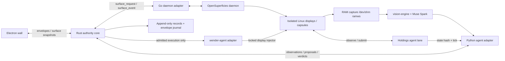
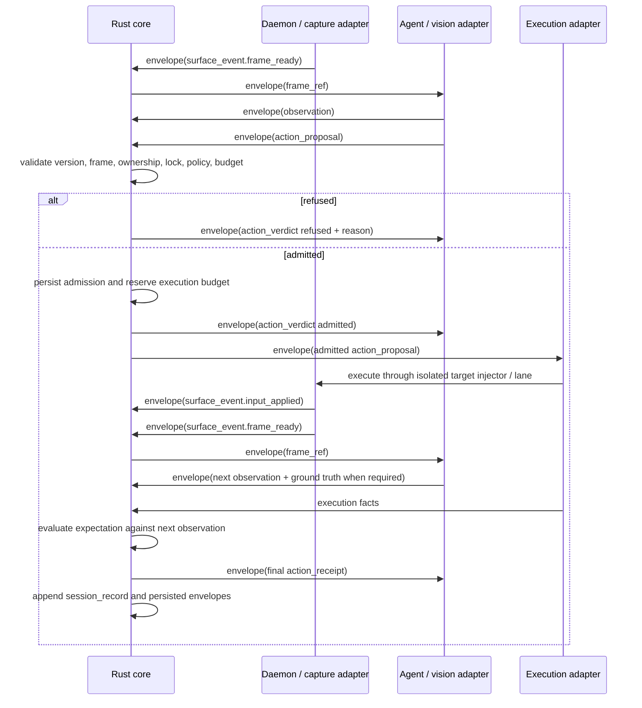

# Architecture

## Context and goals

MetaViewer presents independent Linux application surfaces as a live wall.
Visibility and control are separate: folding a surface saves presentation work
but does not stop capture, agent reasoning or verification. The Rust core is the
single authority over lifecycle, admission, budgets, locks and durable session
order. Electron renders state and submits intents. It never injects input.

Release **0.1.0** [CITED: VERSION] defines the contracts and the integration
laws. All process behavior below is a design target, not implemented runtime
behavior. Assembly begins on **October 26, 2026** [TARGET: operator schedule].



## Process and transport model

The user starts Electron, which launches the Rust core and performs a version
handshake. Electron is the supervisor/launcher; Rust exclusively owns application
state. Rust spawns and supervises the Go daemon through the daemon adapter and
the Python agent/vision/execution adapter processes. They are separate pinned
repositories, not copied code. Children are explicitly terminated and reaped at
session shutdown; crashes move affected surfaces to `lost` and stop admissions.
The UI may reconnect without becoming an authority.

The following are **proposed socket names**, not existing component APIs:

| Socket under `$XDG_RUNTIME_DIR/metaviewer/` | Owner and callers | Contract boundary |
| --- | --- | --- |
| `core.sock` | Core listens; UI and agent adapters connect | envelope, surface intents/snapshots, observation, action_proposal, action_verdict |
| `surfaces.sock` | Daemon adapter listens; core connects | envelope, surface_request, surface_event, surface, frame_ref |
| `executor.sock` | Execution adapter listens; core connects | admitted action_proposal, action_receipt in envelope |

Fail startup if `XDG_RUNTIME_DIR` is missing, unsafe or owned by another user.
Use an owner-only runtime directory and owner-only sockets, validate peer
credentials and bound message sizes. Exact size limits and backpressure policy
are AUSENTE — no inventar; they must be agreed before IPC implementation.
Proposed framing is UTF-8 newline-delimited JSON, disallowing raw newlines inside
strings. A newline terminates an entire JSON value. No network listener is
required. Native daemon and Holdings lane sockets stay behind adapters; capsule
socket locations come from capsule metadata rather than guessed paths.

Every wire message is an `envelope/v0.1` containing a typed body with its own
schema discriminator. Reject unknown versions and unknown properties. `seq`
strictly increases per authenticated sender instance within a session; a fresh
instance starts a fresh sender sequence. Record accepted nonce/sequence pairs
and refuse duplicates before execution, including after restart. `ts_ns` is a
nonnegative monotonic session-clock timestamp; sequence order, not clock order,
is authoritative. Units in field names are normative.

## Contract-first rule and mapping

Add a schema and positive/negative examples before any producer or consumer.
A breaking change creates a new contract directory; existing versions stay
while pinned clients use them. Draft **2020-12** [CITED: task requirements] is the
schema dialect. The local validator implements only the explicitly documented
subset and rejects unknown keywords during its audit; it is not a general
JSON Schema implementation.

| Contract | Producer → consumer | Meaning |
| --- | --- | --- |
| envelope | Any adapter/UI → core; core → adapters/UI | Identity, session, ordered sender sequence, nonce, typed body |
| surface | Core → UI; daemon adapter → core | Authoritative snapshot after validation; UI may submit a desired snapshot as intent |
| surface_request | Core → daemon adapter | Closed per-operation parameters for create/list/destroy/subscriptions/input/record/control |
| surface_event | Daemon adapter → core | Created, lifecycle snapshot, captured frame, applied input or error |
| frame_ref | Capture adapter → core/vision | Immutable RGB frame locator and integrity metadata |
| observation | Agent/vision adapter → core | Frame, optional grounded visual elements and optional Holdings state witness |
| action_proposal | Agent → core → execution adapter | Frame-bound action, next-observation predicate and bounded retries/time |
| action_verdict | Core → agent | Admission/refusal and authoritative sequence; only refusals carry a reason |
| action_receipt | Execution adapter via core verification → log/agent | Execution time, next frame, verification result/method and error text |
| session_record | Core → durable journal | Ordered append-only event referencing a persisted envelope and prior-record digest |

`surface_request.list` has empty parameters; the adapter emits a `created`
snapshot for each current surface in core order. Empty-list completion and
request correlation beyond envelope identifiers remain an open protocol question.
No arbitrary extensible JSON object is permitted in this contract version.
`lane_submit.payload` is a proposed adapter command record with nonce, sequence,
command and string arguments. It is **not** a claim about the native Holdings
wire shape; the adapter must translate it only after that shape is confirmed.
All action variants and all daemon operations have closed parameter objects.
`frame_ref` and the other embedded message-shaped values retain their own
schema discriminator.

## Capture and integration seams

| Component or seam | Existing fact [CITED: task corpus] | Required adapter behavior [TARGET] |
| --- | --- | --- |
| OpenSuperficies / capsules | Go daemon; raw `rgb24` frames | Bridge daemon lifecycle and subscriptions; never decode xpra for authoritative capture |
| RAM capture | Bit-exact X framebuffer through RAM capture into `/dev/shm` ramws | Publish complete immutable generations with dimensions, digest and capture duration; read only after publication |
| vision-engine | Pin `v0.1.1`, commit `cff8f3a` | Tear-free capture, change detection and localisation; window-pixel bounding boxes |
| Muse Spark | Runtime multimodal vision model | Produce visual summaries via agent adapter; credentials remain outside messages |
| wender-agent | Pin `v0.1.1`, commit `f24bda5`; `wender.state/v1`, per-window target locks, budget governor, replay-before-admit | Preserve native checks behind core admission; return execution facts without claiming authority over verification |
| Holdings | Observe/submit lane; nonce+seq refusal; state_sha256 chain; `HOLDINGS_READY <seed> <tick>` | Bind lane to capsule, verify readiness and chain, use state digest plus tick windows |
| Capsule CLI | os-cu-0 is building `srf-holdings-capsule start\|frame\|step\|stop` | Consume returned container, display, framebuffer path, agent-lane socket and ready line; do not guess them |
| OpenNewton | Per-display areas and isolation-locked injectors | Map activa→active, en_espera→standby, cedida→ceded, destruida→destroyed, perdida→lost |

Capture generations increase when a framebuffer allocation or display is
replaced. A digest alone cannot identify freshness across generations. Verify
that mapped bytes have the expected packed RGB size and digest; never use an
unpublished buffer while it is being written. Frame lifetime and reclamation
need an acknowledgement/lease design before runtime implementation.

Holdings pixels are not keyed by state. A pixel change alone cannot prove a
Holdings state transition. Use `ground_truth.source=holdings_lane`, the validated
`state_sha256` chain and a bounded tick interval from the expectation. The
`state_sha256_change` predicate requires a new digest and a tick between
`min_tick` and `max_tick`; the core checks interval ordering and correlation to
the same capsule. Nonce and sequence in the lane payload are also subject to
native replay refusal. A receipt claiming success without the required witness
is refused as an unverified outcome, never silently promoted to success.

## See, propose, admit, act, verify



Execution facts are internal adapter data assembled into the contracted receipt;
the core owns the final `verified` field. Failed verification keeps `verified`
false and a nonempty `error`; successful receipts use an empty error string.
Retries consume the proposal's budget and require fresh admission against the
current frame. An observation must belong to the same surface and generation;
visual predicates use window coordinates, never wall-scaled UI coordinates.

## Fold, unfold, pin and take control

```mermaid
sequenceDiagram
    participant U as Electron UI
    participant C as Rust core
    participant D as Daemon adapter
    participant A as Agent
    U->>C: envelope(surface desired visibility folded/unfolded/pinned)
    C->>C: validate transition; change visibility; append record
    C->>U: envelope(authoritative surface)
    Note over C,A: capture and verified agent loops continue while folded
    U->>C: envelope(surface_request take_control owner=human)
    C->>C: close admission; drain/cancel in-flight action; acquire ownership
    C->>D: envelope(surface_request take_control)
    D->>C: envelope(surface_event state_changed)
    C->>A: envelope(authoritative surface control=human)
    C->>U: envelope(authoritative surface)
    U->>C: envelope(surface_request release_control)
    C->>D: envelope(surface_request release_control)
    D->>C: envelope(surface_event state_changed)
    C->>C: refresh frame and ownership before agent admission resumes
    C->>U: envelope(authoritative surface)
```

A UI-submitted surface is a requested snapshot, not a state write. Only the core
may accept visibility differences; immutable identifiers, display, geometry,
profile, lifecycle and control cannot be changed by this path. Control uses
explicit operations. A shared surface still requires an exclusive injection
lease for each admitted action; human interaction invalidates pending proposals.
Pinning affects layout only. Folding never revokes agent ownership by itself.

## Create and destroy

```mermaid
sequenceDiagram
    participant U as UI
    participant C as Rust core
    participant D as Daemon adapter
    participant S as Capsule / daemon
    U->>C: envelope(surface_request create)
    C->>C: validate profile reference and allowed kind
    C->>D: envelope(surface_request create)
    D->>S: start capsule and await ready line
    S->>D: container/display/framebuffer/lane metadata
    D->>C: envelope(surface_event created)
    C->>C: validate isolation; register surface; append record
    C->>U: envelope(surface)
    U->>C: envelope(surface_request destroy)
    C->>C: stop admission; drain/cancel actions; release leases
    C->>D: envelope(surface_request frame_unsubscribe)
    C->>D: envelope(surface_request destroy)
    D->>S: stop capsule and release resources
    D->>C: envelope(surface_event state_changed destroyed)
    C->>C: append terminal lifecycle record
    C->>U: envelope(surface state=destroyed)
```

Failed readiness produces `surface_event.error`; no agent action is admitted.
Unexpected disappearance yields `lost` rather than a fabricated clean destroy.
A terminal surface cannot be revived under its old identifier.

## Core authority and replay

The core serializes all mutations and assigns `core_seq`. It authenticates the
sender and session before interpreting the body, rejects malformed envelopes
and replayed nonces/sequences, and records refusals as well as admissions.
Protocol errors without a valid proposal identifier are transport errors;
well-formed but inadmissible proposals receive a typed refusal.

| Admission check | Refusal reason |
| --- | --- |
| Digest/generation absent, stale or no longer current | STALE_FRAME |
| Human ownership, terminal/lost lifecycle, disallowed shared ownership | SURFACE_NOT_AGENT_CONTROLLED |
| Another owner holds the display/window injection lease | LOCKED_BY_OTHER |
| Proposal deadline, retries, session or native governor allowance exhausted | BUDGET_EXCEEDED |
| Coordinates or expected bounding boxes exceed the current window | OUT_OF_BOUNDS |
| Unsupported action, unauthorized sender, replay, invalid tick interval or other policy failure | POLICY |

Schema validation is necessary but cannot prove these stateful conditions.
Acquire the display/window lock and reserve budget atomically at admission;
recheck frame and ownership immediately before injection to close races.
Core and native wender replay/lock/budget checks both remain enabled.

Session records are append-only references, **not sufficient replay material
alone**. Persist every referenced envelope and frame/state witness in a session
journal before recording its identifier. The first record uses an all-zero
previous digest as a documented genesis sentinel; subsequent records hash the
previous record's canonical JSON bytes (UTF-8, sorted keys, compact separators,
no newline). `core_seq` starts at the first positive integer and increases
without gaps [TARGET]. Verify the chain, referenced envelopes and witness
hashes before replay. The frame itself remains outside JSON; retained frame
bytes or archived verified state witnesses are required for outcome replay.

Replay reconstructs core state using logged inputs, decisions, ownership
transitions and observations in recorded order. It never reinjects live actions,
queries a live model or rereads wall-clock time. Crash recovery cannot infer
whether an interrupted external input executed: mark its outcome unknown,
refresh ground truth and refuse re-execution until reconciled. Transactional
journaling, crash boundaries and complete record-kind semantics need tests in
the core implementation; this scaffold does not claim runtime determinism.

## Security and platforms

Contracts carry no credentials, tokens, cookies or profile contents. `profile_id`
references an external persistent profile registry. Treat all text and vision
content as untrusted data, not instructions granting privileges. Enforce
surface-to-container/display/window mappings, per-display isolation locks,
owner-only capture buffers and strict runtime peer authentication. Validate
`ramws_path` against the registered capsule allocation, avoid symlink traversal,
and verify its actual bytes; a path-shaped string is not authorization.
Never log secrets in free-text summaries, input text or errors. Session fixtures
are synthetic; runtime capture/log retention and redaction require explicit policy.

Linux is the first target. WSL2 follows after validating display, shared-memory
and socket behavior; macOS requires a Linux VM. Native macOS display control is
outside this design. Capability/capacity measurements are AUSENTE — no inventar.

## Testing and CI

The standard-library tools audit schema identities, object closure and supported
keywords, then require each valid fixture to pass and each invalid fixture to
fail. Each base invalid fixture changes only its schema discriminator. Unit
tests independently exercise types, bounds, strict objects, references,
oneOf ambiguity, malformed schemas and incorrectly labelled examples. Laws
checks cover messages, identities, ranges and version/changelog consistency.
CI runs these gates for pushes, pull requests and manual runs; no runtime builds
exist yet. Assembly gates will add stale-frame and cross-display negative
controls, replay refusal, crash recovery and Holdings state/tick verification.

## Open questions

- OpenSuperficies repository, exact version, commit, native wire protocol and binary delivery: AUSENTE — no inventar. `deps.lock` uses `TBD` until supplied.
- Confirm the proposed adapter payload against the actual Holdings lane and capsule CLI contracts; preserve all native replay fields.
- Agree frame buffer leases, lifetime, capture generation rollover and retention of replay witnesses.
- Specify transport handshake, maximum message size, timeouts, list completion, request correlation and reconnect behavior before implementing sockets.
- Specify profile provisioning and shared-control arbitration; define release behavior for pending actions.
- Prove transactional replay/crash boundaries and budget accounting with failure injection during assembly.
- Validate the proposed surface-as-visibility-intent path; introduce a dedicated versioned UI intent contract if needed before implementation.

This mandate is scoped to the supplied task corpus and the existing repository laws; unmeasured runtime behavior remains unclaimed.
